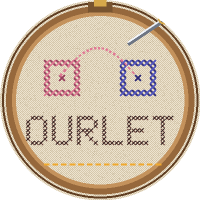

# Ourlet

*Un ourlet, c'est un bord de tissu replié puis cousu. Ici, le tissu, c'est le monde.*

L'**Aiguille Spatiale** coud l'espace entre deux faces de blocs, n'importe où dans une dimension.
Il n'y a ni portail ni nouveau bloc : seulement une couture brodée sur deux blocs qui existent déjà.

## Comment ça marche

1. **Le bâti** — clic droit avec l'aiguille sur une face (un mur, un sol, un plafond).
2. **La couture** — clic droit sur une autre face, à 3 blocs ou à 5 000. Les deux faces sont cousues.
3. **Le passage** — tout ce qui touche une face ressort par l'autre : joueurs, créatures, objets, flèches, boules de neige… La vitesse est conservée et tournée comme la face. Si on tombe dans un sol cousu à un mur, on ressort à l'horizontale, lancé à pleine vitesse.
4. **Les pistons** — un bloc poussé contre une couture passe dans le pli et ressort de l'autre côté.
5. **Le pli tactile** — le regard traverse la couture. Si un mur de ta base est cousu à un filon de diamants à 5 000 blocs :
   - clic droit sur le mur : tu poses une torche ou tu actionnes un levier **près du filon** ;
   - tu casses le mur : c'est **le minerai d'en face** qui cède, au rythme de sa dureté, et les diamants reviennent par le fil. Le mur, lui, ne casse pas.
6. **Découdre** — accroupi + clic droit sur une couture. Si l'un des deux blocs disparaît, le pli se déchire.

| | |
|---|---|
| Recette | perle de l'Ender (haut-droite), lingot de fer (centre), ficelle (bas-gauche) |
| Utilisations | 48 coutures par aiguille |
| Limite | 12 plis par joueur, dans une même dimension |
| Chargement | les deux bouts d'un pli restent chargés : ce qui passe arrive tout de suite |
| Commande | `/ourlet list` |

Les deux bouts d'un pli portent la même couleur de fil (rose, indigo, safran, sauge).

## Versions

| Minecraft | Chargeur | Java |
|---|---|---|
| 1.20.1 | Forge | 17 |
| 1.21 – 1.21.1 | Forge | 21 |
| 1.21 – 1.21.1 | NeoForge | 21 |
| 26.3 | NeoForge | 25 |

Le mod doit être installé sur le serveur **et** sur le client.

## Développement

Même organisation que [fate-flip](https://github.com/Loup0007A/fate-flip) : sources de référence dans `src/main`
(Forge 1.21.1), autres cibles fabriquées par `tools/port.py`, et un workflow GitHub qui compile chaque cible,
lance un vrai serveur et un vrai client de test, publie la release puis envoie les fichiers sur CurseForge
(voir [`curseforge/SETUP.md`](curseforge/SETUP.md)).

---

**English** — *Ourlet* is French for "hem". The Spatial Needle stitches two block faces together: anything that
touches one comes out of the other with its speed preserved, pistons push blocks through, and you can mine,
build and flip levers on the far side by aiming at the seam. Recipe: ender pearl, iron ingot, string (diagonal).
