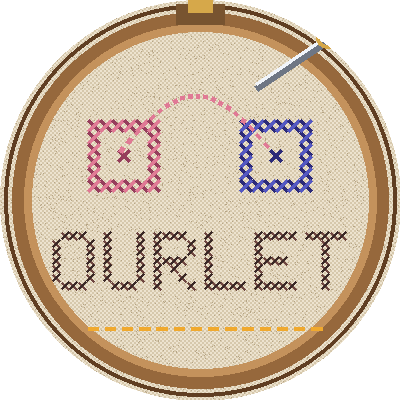

# Textes de la page CurseForge

## Nom

Ourlet — The Spatial Needle

## Summary

Sew two block faces together anywhere in the world: what touches one comes out of the other, and you can mine and build through the seam.

## Description

*"Ourlet" is French for a **hem**: a fold of fabric, stitched down. Here, the fabric is the world.*

The **Spatial Needle** sews the space between two block faces. There's no portal block and no window texture: the seam is embroidered onto two blocks that already exist.

### How it works

1. **Tack.** Right-click a block face with the needle: a wall, a floor or a ceiling.
2. **Sew.** Right-click another face, 3 blocks away or 5,000. The two faces are now stitched together.
3. **Pass through.** Anything that touches one face comes out of the other: players, mobs, items, arrows, snowballs. **Velocity is preserved** and rotated with the face. Fall into a floor seam stitched to a wall and you get **launched sideways** at full speed.
4. **Pistons.** Push a block against a seam and it is pulled through the fold, coming out on the other side.
5. **Touch through the fold.** Your line of sight goes through the seam. Stitch your base wall to a diamond vein 5,000 blocks away, then:
   - **right-click the wall** to place a torch or flip a lever *next to the vein*;
   - **mine the wall** and *the ore on the other side* gives way, as fast as its hardness allows. The drops come back through the thread. The wall itself never breaks.
6. **Unpick.** Sneak + right-click a seam. If either block disappears, the fold tears.

### Details

- Recipe: ender pearl (top-right), iron ingot (center), string (bottom-left).
- 48 seams per needle, 12 folds per player, same dimension only.
- Both ends of a fold stay loaded, so whatever goes through arrives instantly.
- Matching thread colors (rose, indigo, saffron, sage) show which seams belong together.
- Fabric sounds and thread particles, all vanilla, so there's nothing extra to download.
- `/ourlet list` shows your folds.

### Versions

Forge 1.20.1 · Forge 1.21–1.21.1 · NeoForge 1.21–1.21.1 · NeoForge 26.3. **Required on both server and client.**

---

**Français** — L'Aiguille Spatiale coud deux faces de blocs. Ce qui touche l'une ressort par l'autre, vitesse comprise. Les pistons y font passer des blocs, et on peut miner, poser et actionner de l'autre côté en visant la couture.
